# Contato da bola fantasma

Prever a primeira bola atingida e o ponto de contato, com menos trabalho que uma busca completa e com erro aceitável?

O programa compara essa busca com o rastreamento da mesma raiz por uma EDO em θ. A disciplina pede algoritmos numéricos que caibam no tempo de um quadro. A EDO entra só na mira, com as bolas paradas. A tacada é outro cálculo: eventos de colisão, parede e atrito, e o contato desenhado volta à busca.

A mesa abaixo está em `http://127.0.0.1:8000`, com rastreamento, Euler, 6 bolas e K = 30. O X amarelo é o contato do método sobre a bola. A aba Resultados mostra o gráfico que a interface desenha a partir de `benchmark_results.csv`.

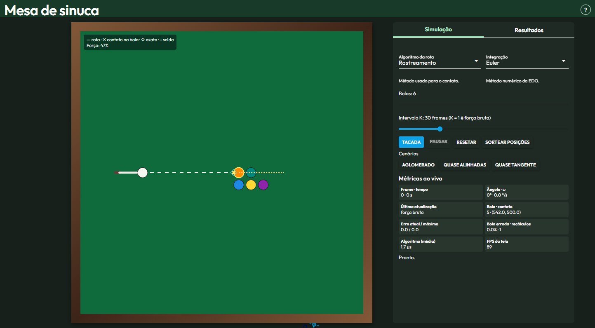

*Mesa 1000×1000. Linha tracejada: rota. X: contato previsto. Painel à direita: controles e métricas do quadro.*

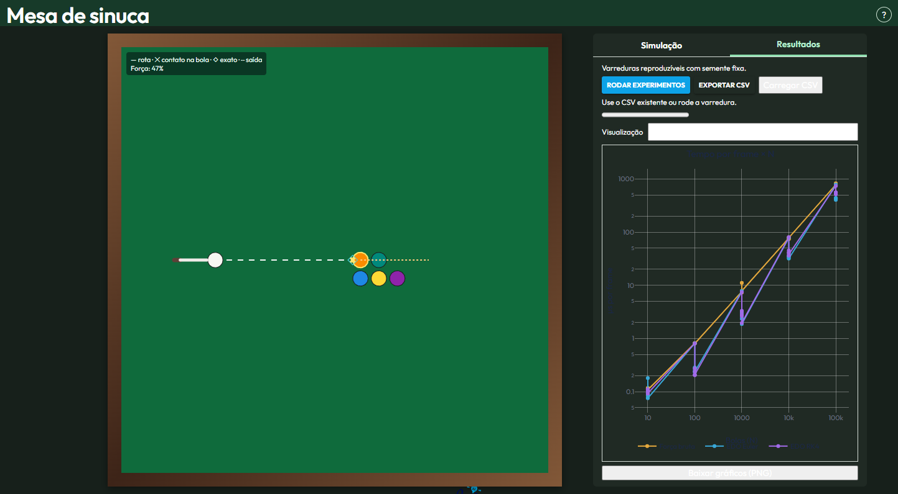

*Aba Resultados com o CSV já carregado. O gráfico da interface junta todos os K de um método na mesma linha. As figuras da seção 8 separam K.*

## Índice

1. [Título e resumo](#contato-da-bola-fantasma)
2. [Modelo matemático](#modelo-matemático)
3. [Algoritmos](#algoritmos)
4. [Arquitetura](#arquitetura)
5. [Instalação e execução](#instalação-e-execução)
6. [Guia da interface](#guia-da-interface)
7. [Metodologia experimental](#metodologia-experimental)
8. [Resultados](#resultados)
9. [Validação](#validação)
10. [Conclusão](#conclusão)
11. [Limitações e trabalhos futuros](#limitações-e-trabalhos-futuros)
12. [Estrutura, autor e licença](#estrutura-autor-e-licença)

## Modelo matemático

A branca é um ponto `c0`. Cada outra bola `i` entra com raio `2R`: o raio da branca mais o raio do alvo. No código, `DEFAULT_RADIUS = 18`, então o círculo da busca tem raio 36 na mesa da interface. A mira é a semirreta

$$P(s) = c_0 + s\, d(\theta), \quad d(\theta) = (\cos\theta,\ \sin\theta), \quad s \ge 0.$$

O contato com a bola `i` é a menor raiz `s > 0` de

$$F(s,\theta) = |c_0 + s\, d(\theta) - c_i|^2 - (2R)^2 = 0.$$

É uma quadrática em `s`. A implementação guarda a raiz `s = -b - sqrt(b² - c)`, com `b = w·d`, `c = |w|² - (2R)²` e `w = c0 - ci` antes de somar `s·d`. Raiz com `s < -S_EPS` (`S_EPS = 1e-9`) é descartada. O alvo é a bola de menor `s` válido.

Com as bolas paradas, `s*(θ)` segue essa raiz. Derivação implícita, com `w = c0 + s·d - ci` e `d' = (-sin θ, cos θ)`:

$$\frac{ds^*}{d\theta} = -\frac{F_\theta}{F_s} = -\frac{s\,(w\cdot d')}{w\cdot d}.$$

`s_derivative` devolve `NaN` quando `|w·d| < TANGENT_EPS` (`TANGENT_EPS = 1e-3`). A variável independente é θ, não o tempo. Euler é um passo de ordem 1. RK4 é um passo de ordem 4. O Δθ do mouse não é quebrado em subpassos.

Três casos tiram o passo da EDO e chamam a busca de novo: `s` não finito ou `s < -S_EPS`; resíduo `| |w| - 2R | > RESIDUAL_LIMIT` (`RESIDUAL_LIMIT = 2`); derivada não finita no θ novo, o que cobre a quase tangência. Troca de bola alvo não aparece na fórmula: a EDO continua na bola em que o rastreamento foi iniciado. O erro desse passo se acumula até o próximo recálculo.

Durante a tacada as bolas andam. `advance_events!` avança até a próxima colisão ou parede, reflete na borda com margem `R` e, na colisão de massas iguais, troca a componente normal. Entre eventos o atrito é constante (`FRICTION = 140`). O contato desenhado nesse trecho é de novo a busca completa. A EDO não rastreia bola em movimento.

## Algoritmos

Busca completa. Para cada bola diferente da branca, resolve a quadrática e fica com o menor `s` válido. Custo `O(N)` por atualização.

```
busca(bolas, θ):
    melhor ← nenhum
    para i em 1:N-1:
        s ← menor raiz ≥ 0 de F(s, θ) = 0 na bola i
        se s é válido e s < melhor.s:
            melhor ← (i, s)
    retorna melhor
```

Rastreamento. Um passo de Euler ou RK4 na bola já escolhida. Sem a busca, o custo é `O(1)`.

```
passo(θ, s, Δθ):
    s ← Euler(θ, s, Δθ) ou RK4(θ, s, Δθ)
    se s inválido ou resíduo > 2 ou w·d abaixo de 1e-3:
        retorna busca
    retorna s
```

Híbrido. A cada `K` atualizações a busca substitui o estado. No meio do intervalo vale o passo, com as mesmas correções.

```
atualizar(frame, K):
    se frame mod K = 0 ou não há bola rastreada:
        contato ← busca
    senão:
        contato ← passo
        se o passo foi rejeitado:
            contato ← busca
```

`K = 1` chama a busca em toda atualização. O erro fica em zero por construção. Isso é teste de sanidade, não um resultado do rastreamento.

## Arquitetura

Não há `ccall` nem biblioteca compartilhada. A mesa chama Julia. O C++ é um executável separado, usado só no botão que grava o CSV.

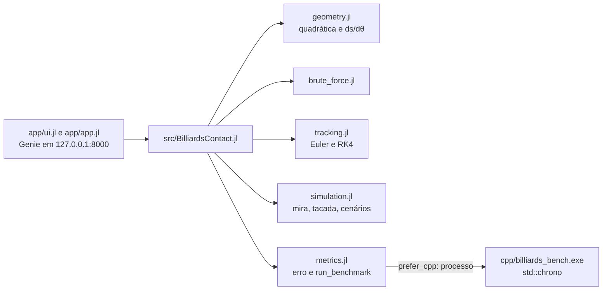

`types.jl` guarda bola, contato e estado. `geometry.jl` resolve a raiz e a derivada. `brute_force.jl` escolhe o menor `s`. `tracking.jl` integra em θ. `simulation.jl` aplica a mira, a tacada por eventos e as cenas. `metrics.jl` mede erro, taxa de bola errada e tempo. Com `prefer_cpp = true`, e o botão da interface usa esse valor, `run_benchmark` executa `cpp/billiards_bench.exe` e lê o CSV de volta.

## Instalação e execução

Comandos executados nesta máquina, na raiz do projeto.

| Peça | Versão usada |
|---|---|
| Julia | 1.13.2 (`julia --version`). `Project.toml` declara compatibilidade `julia = 1.10` |
| GenieFramework | 3.1.0, puxando Genie 6.1.0 |
| PlotlyBase | 0.8.23 |
| StaticArrays | 1.9.22 |
| Compilador C++ | MSVC do Visual Studio 2022 Community. `g++` não está no PATH. `cl` só entra depois de `vcvars64.bat` |
| CMake / make | não existem neste repositório |

Dependências e testes:

```powershell
julia --project=. -e "using Pkg; Pkg.instantiate()"
julia --project=. -e "using Pkg; Pkg.test()"
```

`Pkg.test` terminou com 236 testes passados, em 3,6 s.

Núcleo C++. O comentário de `cpp/benchmark.cpp` cita `g++`; esse binário não está instalado aqui. A compilação que rodou foi:

```powershell
New-Item -ItemType Directory -Force -Path tmp | Out-Null
cmd /c "call `"C:\Program Files\Microsoft Visual Studio\2022\Community\VC\Auxiliary\Build\vcvars64.bat`" && cl /nologo /O2 /EHsc /std:c++17 /Fe:tmp\billiards_bench_check.exe cpp\benchmark.cpp"
```

O repositório já traz `cpp/billiards_bench.exe`. Nesta sessão ele foi executado assim, e o executável recompilado no comando acima também:

```powershell
New-Item -ItemType Directory -Force -Path tmp | Out-Null
.\cpp\billiards_bench.exe tmp\bench_check.csv tmp\bench_check.svg
.\tmp\billiards_bench_check.exe tmp\bench_rebuilt.csv tmp\bench_rebuilt.svg
```

Os dois terminam e gravam as 90 linhas. Esses CSV temporários não foram mantidos. O arquivo usado nas figuras é `benchmark_results.csv`, já presente na raiz. Não foi regravado. O `.gitignore` lista esse nome: um clone novo não recebe o arquivo. Os argumentos do programa são o caminho do CSV e o caminho do SVG.

Interface:

```powershell
julia --project=. app\app.jl
```

Abre `http://127.0.0.1:8000`. O processo escuta em `127.0.0.1`, porta 8000.

Figuras deste README:

```powershell
julia --project=. scripts/plot_benchmark.jl
julia --project=. scripts/convergence.jl
```

O primeiro lê `benchmark_results.csv` e escreve `docs/img/` e `docs/tabela_resumo.md`. O segundo repete a cena de `test/tracking_test.jl` e escreve `docs/img/convergencia.svg`.

Se o executável C++ não existir, o botão "Rodar experimentos" cai em `run_benchmark` sem o processo. Essa função Julia não reproduz o CSV: o padrão é `N` em {10, 100, 1000}, 80 frames, aquecimento 4 e uma repetição. O CSV deste texto vem do executável: `N` até 100000, 40 frames, aquecimento 8, 5 repetições.

## Guia da interface

### Controles

| Controle | Valores | Efeito |
|---|---|---|
| Algoritmo da rota | Força bruta, Rastreamento | Escolhe a busca ou a EDO na mira. Padrão: Rastreamento |
| Integração | Euler, RK4 | Integrador do passo em θ. Padrão: Euler. Ignorado pela força bruta |
| Bolas | inteiro de 2 a 16, passo 1 | Quantidade de bolas da cena. Padrão: 6 |
| Intervalo K | inteiro de 1 a 120 | Frames entre buscas completas. O rótulo diz que K = 1 é força bruta. Padrão: 30 |
| Arrasto na mesa | ângulo do ponteiro | Gira a mira. O Δθ do gesto é um passo da EDO |
| Setas esquerda e direita | ±0,5° | `app/ui.jl` soma ou subtrai `0.5 * π/180` radianos |
| Puxar o taco | força de 80 a 800 | O ponteiro precisa começar no taco. Soltar depois de um recuo de 28 unidades dispara a tacada |
| Tacada | botão | Chama `strike!` com o ângulo e a força atuais e liga o movimento |
| Pausar / Continuar | botão | Só age com bolas em movimento. O texto troca entre Pausar e Continuar |
| Resetar | botão | Volta a cena parada |
| Sortear posições | botão | `random_resting_balls`, semente nova a cada clique. A branca fica em (220, 500) |

### Cenários

| Botão | O que o código faz |
|---|---|
| Aglomerado | `demo_scenario(:cluster, ...)` não tem ramo próprio: cai em `rack_balls`. O status muda para "Cenário aglomerado." A geometria é o triângulo inicial, não um aglomerado separado |
| Quase alinhadas | Bolas 2 e 3 em (570, 482) e (570, 518), branca em (220, 500). As duas entradas ficam próximas; um giro pequeno troca o menor `s` |
| Quase tangente | Bola 2 em (590, 535.7), branca em (220, 500). A reta horizontal passa perto da tangência, onde `w·d` se aproxima de zero |

### Métricas do painel

A mesa da interface mede 1000×1000. O erro é a distância entre centros da bola fantasma, em unidades da mesa, sem dividir por `R`. O X amarelo e o losango ciano são desenhados na superfície da bola; o número do erro não usa esses pontos da superfície.

| Nome no painel | Definição | Unidade |
|---|---|---|
| Frame | Contador de `step!` | quadro |
| tempo | Tempo simulado | s |
| Ângulo | `aim_deg` | grau |
| ω | Variação de `aim_deg` medida no navegador | °/s. Não é rotação da bola |
| Última atualização | `:tracking` ou a busca, conforme o último passo | texto |
| Bola | Índice da bola de menor `s` | índice |
| contato | Centro da bola fantasma | unidade da mesa |
| Erro atual / máximo | Distância entre o centro previsto e o centro da busca, e o máximo desde o reset | unidade da mesa |
| Bola errada | Índice previsto diferente do índice da busca | contagem na sessão |
| recálculos | Vezes em que a busca substituiu o rastreamento nesta sessão | contagem |
| Algoritmo (média) | Média das durações do passo de contato | µs |
| FPS da tela | Quadros do `requestAnimationFrame` em cerca de 500 ms | 1/s da tela, não do algoritmo |

### Desenho

| Marca | Significado |
|---|---|
| Linha tracejada branca | Rota `P(s)` |
| X amarelo | Contato do método na superfície da bola |
| Losango ciano | Contato da busca, na superfície |
| Linha pontilhada | Saída depois do contato |
| Borda amarela | Bola escolhida pelo método |
| Borda ciano | Bola da busca, quando o índice difere |
| Texto "bola errada" | O índice da busca não é o índice do método |
| Segmento vermelho e Δ | Distância entre centros fantasma maior que 0,5 |

## Metodologia experimental

A referência é a força bruta: a mesma quadrática, resolvida de novo a cada amostra. O erro de uma amostra é a distância entre os dois centros fantasma. Se os índices diferem, a amostra conta como bola errada. `wrong_ball_rate` é `100 * erros_de_índice / comparações`.

A grade está em `main` de `cpp/benchmark.cpp`:

- `N` = 10, 100, 1.000, 10.000, 100.000
- `K` = 1, 5, 10, 30, 60, 120
- métodos: força bruta, rastreamento Euler, rastreamento RK4
- 6 × 5 × 3 = 90 linhas
- 40 atualizações medidas por repetição, 5 repetições, 8 passos de aquecimento fora do relógio
- giro de 0,01 rad por atualização
- mesa de lado 1000, branca em `(0.22 * 1000, 0.5 * 1000)`, semente `mt19937_64(1)`

O raio é `benchmark_radius`: `18 * sqrt(10 / N)`. O comentário no fonte diz que a escala existe para a fração de área ficar baixa quando `N` cresce. No CSV: 18; 5,692; 1,8; 0,5692; 0,18.

Média, mediana e p99 saem das 200 durações medidas (40 × 5). O p99 é o elemento de índice `ceil(0.99 * n)` depois da ordenação, com índice em base 1. O ganho da tabela é o tempo médio da força bruta no mesmo `N` e `K`, dividido pelo tempo médio da linha. Não é a razão das colunas `mean_brute_force_time_s` e `mean_tracking_time_s` de uma mesma linha: nessas colunas o tempo da linha vai para uma e a outra fica em zero.

Recálculos: uma busca inicial por repetição, só se ela for válida, mais cada busca nos frames medidos. O aquecimento não entra. Para `K = 30`, o contador interno passa por 8 passos de aquecimento e 40 medidos; o único múltiplo de 30 nesse intervalo cai no frame medido, uma vez por repetição.

### Campos do CSV

| Campo | Conteúdo |
|---|---|
| `n_balls` | `N`, incluindo a branca |
| `radius` | `18 * sqrt(10 / N)` |
| `recalculation_interval` | `K` |
| `algorithm` | `brute_force` ou `tracking` |
| `numerical_method` | `euler`, `rk4`, ou `-` na força bruta |
| `frames` | 40 |
| `repetitions` | 5 |
| `mean_frame_time_s` | Média do tempo do passo, em segundos |
| `median_frame_time_s` | Mediana |
| `p99_frame_time_s` | Percentil 99 como acima |
| `fps` | `1 / mean_frame_time_s` se a média é positiva. É capacidade do algoritmo. Não é o FPS da tela |
| `mean_brute_force_time_s` | A média da linha, se o algoritmo é a busca; senão 0 |
| `mean_tracking_time_s` | A média da linha, se o algoritmo é rastreamento; senão 0 |
| `mean_error` | Média das distâncias entre centros fantasma |
| `max_error` | Máximo dessas distâncias |
| `wrong_ball_rate` | Porcentagem de índices diferentes |
| `recalculations` | Buscas contadas na grade, como acima |

## Resultados

As figuras e a tabela saem de `scripts/plot_benchmark.jl` sobre `benchmark_results.csv`. Cada ponto é uma linha do CSV. Linhas ligam só o mesmo método ao longo de um eixo, com o outro eixo fixo.

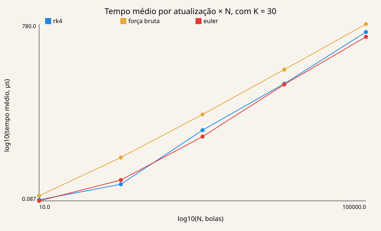

*Eixos em log10. K fixo em 30, para não ligar K diferentes. Unidade do tempo: µs. Em N = 10 os três métodos ficam perto de 0,1 µs. A partir de N = 100 a busca sobe mais que o rastreamento. Em N = 100000 a distância entre as curvas é menor que um fator 30.*

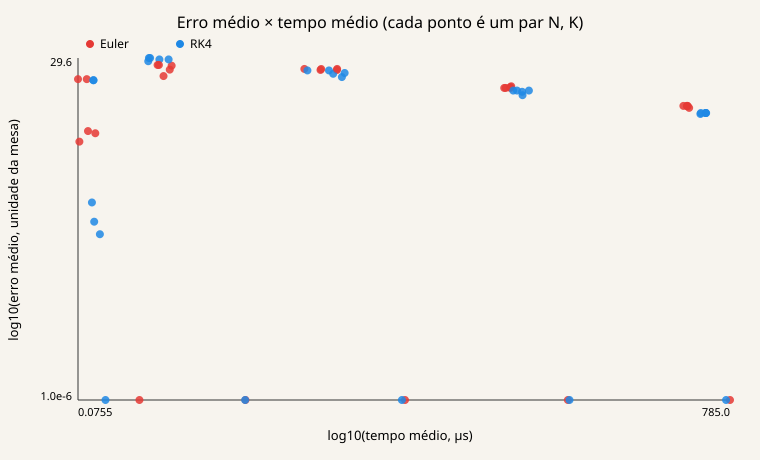

*Cada ponto é um par (N, K) de rastreamento. Não há segmento entre pontos. Eixos em log10. À esquerda, tempos curtos; abaixo, erro pequeno. Pontos com erro médio 0, os de K = 1, foram desenhados em 10⁻⁶ para caber no log. Esse zero é o recálculo em todo frame.*

Erro médio e bola errada, um gráfico por N. A linha de cada método segue só K.

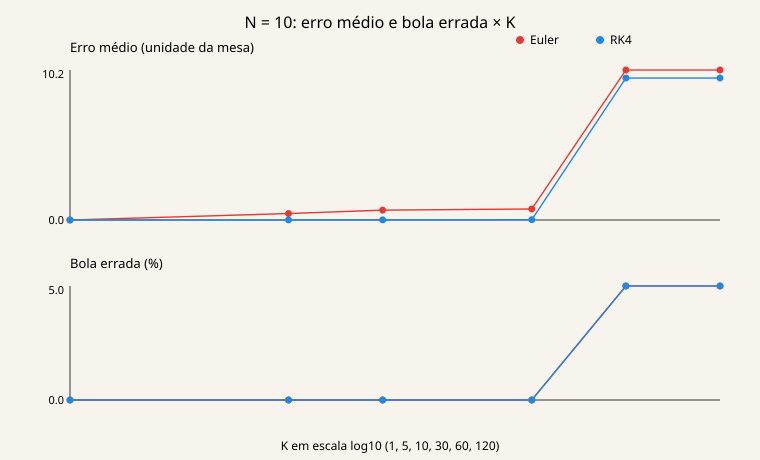

*N = 10. Até K = 30 a bola errada fica em 0. O erro do RK4 fica abaixo do Euler. Em K = 60 e K = 120 os dois métodos passam a 5% de bola errada e o erro médio vai a cerca de 10.*

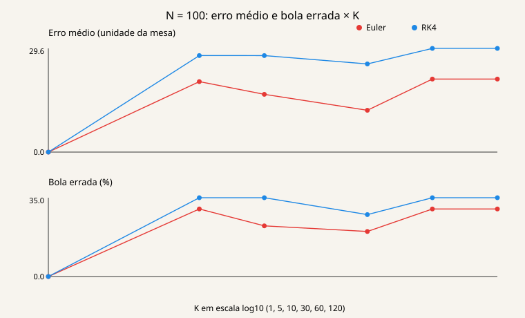

*N = 100. Fora de K = 1, a bola errada fica entre 20% e 35%. O RK4 não fica abaixo do Euler neste N.*

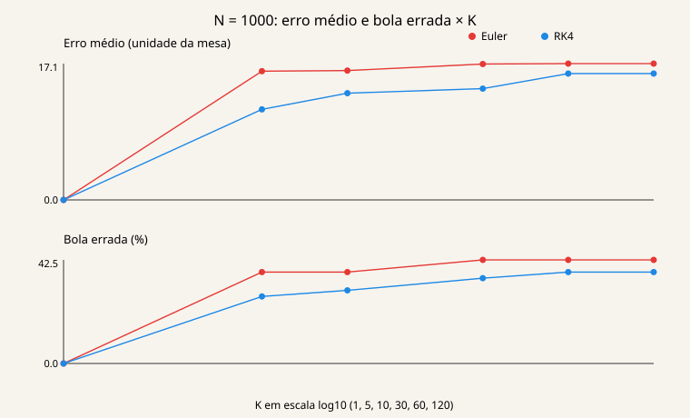

*N = 1000. Bola errada entre 27,5% e 42,5% para K > 1. Erro médio da ordem de 10.*

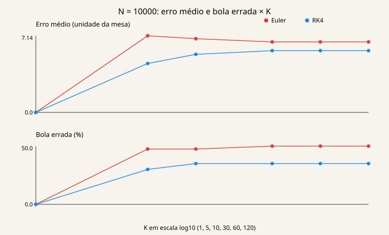

*N = 10000. Euler fica em 47,5% ou 50% de bola errada. RK4 fica em 30% ou 35%, com erro médio menor que o do Euler.*

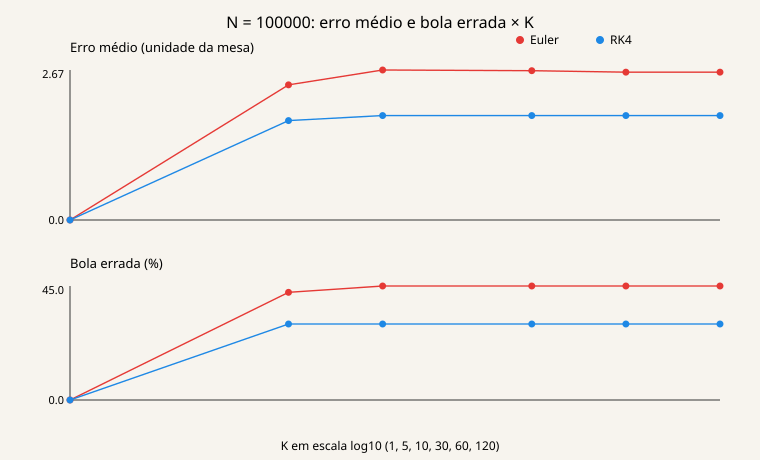

*N = 100000. O erro médio numérico fica na ordem de 2, porque o raio da cena é 0,18. A bola errada continua em 30% (RK4) ou 42,5–45% (Euler) para todo K > 1.*

A tabela completa está em `docs/tabela_resumo.md`. Ganho é tempo da busca dividido pelo tempo da linha, no mesmo N e K. Tempos em µs. Erro em unidade da mesa.

| N | K | método | média (µs) | mediana (µs) | p99 (µs) | ganho | erro médio | erro máximo | bola errada (%) | recálculos |
|---:|---:|---|---:|---:|---:|---:|---:|---:|---:|---:|
| 10 | 1 | força bruta | 0.1165 | 0.1 | 0.2 | 1.0 | 0.0 | 0.0 | 0.0 | 200 |
| 10 | 1 | euler | 0.1805 | 0.1 | 0.2 | 0.6454 | 0.0 | 0.0 | 0.0 | 200 |
| 10 | 1 | rk4 | 0.1115 | 0.1 | 0.2 | 1.045 | 0.0 | 0.0 | 0.0 | 200 |
| 10 | 5 | força bruta | 0.1165 | 0.1 | 0.2 | 1.0 | 0.0 | 0.0 | 0.0 | 200 |
| 10 | 5 | euler | 0.077 | 0.1 | 0.2 | 1.513 | 0.4406 | 2.062 | 0.0 | 95 |
| 10 | 5 | rk4 | 0.103 | 0.1 | 0.2 | 1.131 | 0.004185 | 0.05202 | 0.0 | 85 |
| 10 | 10 | força bruta | 0.116 | 0.1 | 0.2 | 1.0 | 0.0 | 0.0 | 0.0 | 200 |
| 10 | 10 | euler | 0.0965 | 0.1 | 0.2 | 1.202 | 0.6727 | 2.376 | 0.0 | 90 |
| 10 | 10 | rk4 | 0.095 | 0.1 | 0.2 | 1.221 | 0.007855 | 0.05202 | 0.0 | 70 |
| 10 | 30 | força bruta | 0.113 | 0.1 | 0.2 | 1.0 | 0.0 | 0.0 | 0.0 | 200 |
| 10 | 30 | euler | 0.087 | 0.1 | 0.2 | 1.299 | 0.7509 | 2.813 | 0.0 | 85 |
| 10 | 30 | rk4 | 0.092 | 0.1 | 0.2 | 1.228 | 0.02067 | 0.05202 | 0.0 | 60 |
| 10 | 60 | força bruta | 0.1085 | 0.1 | 0.2 | 1.0 | 0.0 | 0.0 | 0.0 | 200 |
| 10 | 60 | euler | 0.0855 | 0.1 | 0.2 | 1.269 | 10.23 | 198.3 | 5.0 | 80 |
| 10 | 60 | rk4 | 0.094 | 0.1 | 0.2 | 1.154 | 9.682 | 201.5 | 5.0 | 60 |
| 10 | 120 | força bruta | 0.1085 | 0.1 | 0.2 | 1.0 | 0.0 | 0.0 | 0.0 | 200 |
| 10 | 120 | euler | 0.0755 | 0.1 | 0.2 | 1.437 | 10.23 | 198.3 | 5.0 | 80 |
| 10 | 120 | rk4 | 0.094 | 0.1 | 0.2 | 1.154 | 9.682 | 201.5 | 5.0 | 60 |
| 100 | 1 | força bruta | 0.8185 | 0.8 | 1.1 | 1.0 | 0.0 | 0.0 | 0.0 | 200 |
| 100 | 1 | euler | 0.812 | 0.8 | 0.9 | 1.008 | 0.0 | 0.0 | 0.0 | 200 |
| 100 | 1 | rk4 | 0.8085 | 0.8 | 0.9 | 1.012 | 0.0 | 0.0 | 0.0 | 200 |
| 100 | 5 | força bruta | 0.815 | 0.8 | 1.0 | 1.0 | 0.0 | 0.0 | 0.0 | 200 |
| 100 | 5 | euler | 0.285 | 0.1 | 0.9 | 2.86 | 20.13 | 194.9 | 30.0 | 60 |
| 100 | 5 | rk4 | 0.273 | 0.1 | 0.9 | 2.985 | 27.57 | 193.9 | 35.0 | 50 |
| 100 | 10 | força bruta | 0.8185 | 0.8 | 1.0 | 1.0 | 0.0 | 0.0 | 0.0 | 200 |
| 100 | 10 | euler | 0.2775 | 0.1 | 1.1 | 2.95 | 16.5 | 198.6 | 22.5 | 55 |
| 100 | 10 | rk4 | 0.2395 | 0.1 | 0.9 | 3.418 | 27.57 | 193.8 | 35.0 | 40 |
| 100 | 30 | força bruta | 0.811 | 0.8 | 1.0 | 1.0 | 0.0 | 0.0 | 0.0 | 200 |
| 100 | 30 | euler | 0.254 | 0.1 | 0.9 | 3.193 | 11.94 | 61.55 | 20.0 | 50 |
| 100 | 30 | rk4 | 0.2045 | 0.1 | 0.9 | 3.966 | 25.18 | 193.9 | 27.5 | 30 |
| 100 | 60 | força bruta | 0.818 | 0.8 | 1.0 | 1.0 | 0.0 | 0.0 | 0.0 | 200 |
| 100 | 60 | euler | 0.2335 | 0.1 | 0.9 | 3.503 | 20.86 | 200.2 | 30.0 | 45 |
| 100 | 60 | rk4 | 0.2065 | 0.1 | 0.9 | 3.961 | 29.63 | 193.8 | 35.0 | 30 |
| 100 | 120 | força bruta | 0.8035 | 0.8 | 0.9 | 1.0 | 0.0 | 0.0 | 0.0 | 200 |
| 100 | 120 | euler | 0.238 | 0.1 | 1.0 | 3.376 | 20.86 | 200.2 | 30.0 | 45 |
| 100 | 120 | rk4 | 0.21 | 0.1 | 0.9 | 3.826 | 29.63 | 193.8 | 35.0 | 30 |
| 1000 | 1 | força bruta | 7.63 | 7.3 | 11.5 | 1.0 | 0.0 | 0.0 | 0.0 | 200 |
| 1000 | 1 | euler | 7.81 | 7.3 | 12.4 | 0.977 | 0.0 | 0.0 | 0.0 | 200 |
| 1000 | 1 | rk4 | 7.472 | 7.3 | 11.3 | 1.021 | 0.0 | 0.0 | 0.0 | 200 |
| 1000 | 5 | força bruta | 7.338 | 7.3 | 8.9 | 1.0 | 0.0 | 0.0 | 0.0 | 200 |
| 1000 | 5 | euler | 2.971 | 0.1 | 7.7 | 2.47 | 16.14 | 187.0 | 37.5 | 80 |
| 1000 | 5 | rk4 | 3.19 | 0.1 | 7.9 | 2.3 | 11.35 | 187.4 | 27.5 | 85 |
| 1000 | 10 | força bruta | 7.63 | 7.3 | 11.8 | 1.0 | 0.0 | 0.0 | 0.0 | 200 |
| 1000 | 10 | euler | 2.355 | 0.1 | 9.6 | 3.24 | 16.22 | 187.0 | 37.5 | 60 |
| 1000 | 10 | rk4 | 2.819 | 0.1 | 11.1 | 2.706 | 13.38 | 187.4 | 30.0 | 70 |
| 1000 | 30 | força bruta | 7.456 | 7.3 | 11.2 | 1.0 | 0.0 | 0.0 | 0.0 | 200 |
| 1000 | 30 | euler | 2.378 | 0.1 | 11.4 | 3.136 | 17.04 | 188.6 | 42.5 | 55 |
| 1000 | 30 | rk4 | 3.316 | 0.2 | 12.2 | 2.248 | 13.96 | 187.3 | 35.0 | 55 |
| 1000 | 60 | força bruta | 11.14 | 11.0 | 12.6 | 1.0 | 0.0 | 0.0 | 0.0 | 200 |
| 1000 | 60 | euler | 2.981 | 0.1 | 15.3 | 3.736 | 17.09 | 188.6 | 42.5 | 50 |
| 1000 | 60 | rk4 | 2.655 | 0.1 | 11.8 | 4.195 | 15.84 | 187.3 | 37.5 | 45 |
| 1000 | 120 | força bruta | 7.859 | 7.3 | 11.5 | 1.0 | 0.0 | 0.0 | 0.0 | 200 |
| 1000 | 120 | euler | 1.873 | 0.1 | 7.6 | 4.196 | 17.09 | 188.6 | 42.5 | 50 |
| 1000 | 120 | rk4 | 1.956 | 0.1 | 11.6 | 4.018 | 15.84 | 187.3 | 37.5 | 45 |
| 10000 | 1 | força bruta | 77.2 | 72.2 | 120.7 | 1.0 | 0.0 | 0.0 | 0.0 | 200 |
| 10000 | 1 | euler | 78.68 | 72.4 | 126.9 | 0.9811 | 0.0 | 0.0 | 0.0 | 200 |
| 10000 | 1 | rk4 | 80.52 | 72.3 | 228.9 | 0.9587 | 0.0 | 0.0 | 0.0 | 200 |
| 10000 | 5 | força bruta | 80.04 | 72.5 | 137.4 | 1.0 | 0.0 | 0.0 | 0.0 | 200 |
| 10000 | 5 | euler | 35.24 | 0.2 | 108.9 | 2.271 | 7.143 | 54.69 | 47.5 | 95 |
| 10000 | 5 | rk4 | 41.37 | 71.4 | 109.2 | 1.935 | 4.56 | 52.76 | 30.0 | 110 |
| 10000 | 10 | força bruta | 78.75 | 73.8 | 120.6 | 1.0 | 0.0 | 0.0 | 0.0 | 200 |
| 10000 | 10 | euler | 34.81 | 0.1 | 90.6 | 2.262 | 6.867 | 54.69 | 47.5 | 95 |
| 10000 | 10 | rk4 | 41.14 | 70.4 | 144.9 | 1.914 | 5.411 | 52.76 | 35.0 | 105 |
| 10000 | 30 | força bruta | 75.01 | 72.2 | 139.8 | 1.0 | 0.0 | 0.0 | 0.0 | 200 |
| 10000 | 30 | euler | 34.82 | 0.1 | 164.3 | 2.154 | 6.57 | 40.89 | 50.0 | 85 |
| 10000 | 30 | rk4 | 36.25 | 0.2 | 111.1 | 2.069 | 5.756 | 39.68 | 35.0 | 95 |
| 10000 | 60 | força bruta | 74.35 | 72.1 | 162.8 | 1.0 | 0.0 | 0.0 | 0.0 | 200 |
| 10000 | 60 | euler | 32.58 | 0.1 | 117.3 | 2.282 | 6.57 | 40.89 | 50.0 | 85 |
| 10000 | 60 | rk4 | 45.27 | 0.4 | 148.0 | 1.642 | 5.756 | 39.68 | 35.0 | 95 |
| 10000 | 120 | força bruta | 78.46 | 72.4 | 113.0 | 1.0 | 0.0 | 0.0 | 0.0 | 200 |
| 10000 | 120 | euler | 31.91 | 0.1 | 108.9 | 2.459 | 6.57 | 40.89 | 50.0 | 85 |
| 10000 | 120 | rk4 | 38.24 | 0.3 | 128.4 | 2.052 | 5.756 | 39.68 | 35.0 | 95 |
| 100000 | 1 | força bruta | 782.1 | 739.5 | 1361.0 | 1.0 | 0.0 | 0.0 | 0.0 | 205 |
| 100000 | 1 | euler | 784.9 | 734.8 | 1543.0 | 0.9964 | 0.0 | 0.0 | 0.0 | 205 |
| 100000 | 1 | rk4 | 742.2 | 729.1 | 1051.0 | 1.054 | 0.0 | 0.0 | 0.0 | 205 |
| 100000 | 5 | força bruta | 764.1 | 731.1 | 1205.0 | 1.0 | 0.0 | 0.0 | 0.0 | 205 |
| 100000 | 5 | euler | 439.7 | 715.9 | 1108.0 | 1.738 | 2.409 | 11.14 | 42.5 | 120 |
| 100000 | 5 | rk4 | 515.9 | 720.4 | 883.6 | 1.481 | 1.772 | 10.78 | 30.0 | 145 |
| 100000 | 10 | força bruta | 763.6 | 729.9 | 1158.0 | 1.0 | 0.0 | 0.0 | 0.0 | 205 |
| 100000 | 10 | euler | 427.1 | 713.2 | 1126.0 | 1.788 | 2.674 | 11.31 | 45.0 | 115 |
| 100000 | 10 | rk4 | 554.8 | 728.6 | 1229.0 | 1.376 | 1.862 | 10.78 | 30.0 | 145 |
| 100000 | 30 | força bruta | 780.0 | 730.9 | 1421.0 | 1.0 | 0.0 | 0.0 | 0.0 | 205 |
| 100000 | 30 | euler | 405.2 | 713.4 | 842.0 | 1.925 | 2.661 | 11.31 | 45.0 | 115 |
| 100000 | 30 | rk4 | 518.8 | 717.2 | 966.7 | 1.504 | 1.862 | 10.78 | 30.0 | 145 |
| 100000 | 60 | força bruta | 746.5 | 729.3 | 926.2 | 1.0 | 0.0 | 0.0 | 0.0 | 205 |
| 100000 | 60 | euler | 426.2 | 715.1 | 1130.0 | 1.752 | 2.635 | 11.31 | 45.0 | 115 |
| 100000 | 60 | rk4 | 555.6 | 728.1 | 1322.0 | 1.343 | 1.862 | 10.78 | 30.0 | 145 |
| 100000 | 120 | força bruta | 829.1 | 742.7 | 1262.0 | 1.0 | 0.0 | 0.0 | 0.0 | 205 |
| 100000 | 120 | euler | 431.1 | 715.5 | 1120.0 | 1.923 | 2.635 | 11.31 | 45.0 | 115 |
| 100000 | 120 | rk4 | 559.5 | 727.9 | 1306.0 | 1.482 | 1.862 | 10.78 | 30.0 | 145 |

Leitura de três pontos, com os números do CSV.

Em N = 10 e K = 5, Euler tem erro médio 0,4406 e RK4 tem 0,004185. Os dois têm bola errada 0. O ganho sobre a busca é 1,513 e 1,131. Mediana e p99 são 0,1 µs e 0,2 µs nas três linhas, inclusive na busca. A média muda dentro dessa grade do relógio. Em K = 1, no mesmo N, o Euler fica mais lento que a busca: ganho 0,6454, erro 0.

Em N = 100 e K = 30, a busca leva 0,811 µs. Euler leva 0,254 µs (ganho 3,193) com erro médio 11,94, erro máximo 61,55 e 20% de bola errada. RK4 leva 0,2045 µs (ganho 3,966) com erro médio 25,18, erro máximo 193,9 e 27,5% de bola errada. O tempo cai. A bola escolhida erra em uma fração grande das amostras. RK4 não corrige essa escolha: nesta linha erra mais que Euler e recalcula menos (30 contra 50). O agendamento de K = 30 contribui 5 buscas medidas; o resto da coluna é correção antecipada.

Em N = 100000 e K = 30, a busca leva 780,0 µs. Dividir por K daria 26,0 µs se as outras 29 atualizações não custassem e se não houvesse correção. Euler mediu 405,2 µs (ganho 1,925) e RK4 mediu 518,8 µs (ganho 1,504). A coluna de recálculos é 115 e 145. A linha K = 1 deste N tem 205, isto é, 5 a mais que 40 × 5: a busca inicial de cada repetição entrou porque foi válida. Tirando essas 5 iniciais, que estão fora do relógio, restam 110 e 140 buscas dentro dos 200 frames. A conta (110 / 200) × 780,0 µs = 429 µs, e (140 / 200) × 780,0 µs = 546 µs. Os tempos medidos são 405,2 µs e 518,8 µs. A ordem coincide com a fração de frames que ainda fazem a busca. O CSV não separa o tempo da correção do tempo do passo da EDO, então a diferença até 429 e 546 não tem uma segunda causa identificada aqui. A mediana do Euler é 713,4 µs, perto da mediana da busca (730,9 µs): mais da metade das amostras ainda é uma busca, e a mediana não acompanha a queda da média.

No N pequeno a busca não perde de forma estável. Em N = 10, mediana e p99 são iguais nas 18 linhas. Em K = 1, para N de 100 a 100000, o ganho do rastreamento fica entre 0,9587 e 1,054. K = 1 tem erro 0 porque recalcula sempre.

## Validação

### Ordem do integrador

Experimento separado de `scripts/convergence.jl`, a mesma cena de `head_on_error` em `test/tracking_test.jl`: raio 18, bolas em (0, 0) e (220, 24), giro total 0,04 rad, `K = 10^9` para não haver recálculo agendado. O passo Δθ varia. O teste da suíte usa 0,002 e 0,001 e exige ordem de Euler entre 0,7 e 1,4 e ordem de RK4 acima de 3. A figura usa também 0,008, 0,004 e 0,0005. Nenhum desses passos caiu na busca: `fallbacks = 0` em todos.

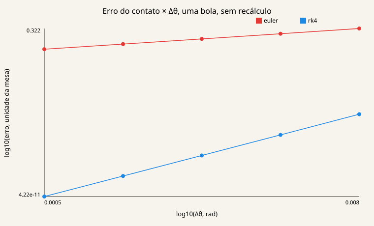

*log10 do erro contra log10 de Δθ, em radianos. A inclinação é a ordem observada.*

| Δθ (rad) | erro Euler | ordem Euler | erro RK4 | ordem RK4 |
|---:|---:|---:|---:|---:|
| 0,008 | 0,3216 |  | 2,929e-6 |  |
| 0,004 | 0,1580 | 1,025 | 1,779e-7 | 4,041 |
| 0,002 | 0,07833 | 1,012 | 1,094e-8 | 4,023 |
| 0,001 | 0,03900 | 1,006 | 6,779e-10 | 4,012 |
| 0,0005 | 0,01946 | 1,003 | 4,218e-11 | 4,006 |

A ordem é `log(e(h) / e(h/2)) / log(2)`. Euler fica em 1,00–1,03. RK4 fica em 4,01–4,04.

A interface tinha um gráfico chamado Convergência que usava `K/60` no eixo e desenhava retas de ordem 1 e 4. Esse gráfico foi removido do seletor, do desenho e da exportação. Não media Δθ.

### Momento e energia

`test/pool_test.jl` coloca duas bolas de raio 18 em (100, 200) e (140, 200). A primeira tem velocidade (40, −10); a segunda está parada. `advance_balls!` avança 0,2 s com `friction = 0` e `collide = true`. O momento do modelo é a soma das velocidades, porque a massa não entra. A energia cinética é `0,5 * soma(v²)`. O teste exige os dois iguais aos valores iniciais com `atol = 1e-6`, e o momento inicial igual a (40, −10) com `atol = 1e-9`.

O mesmo arquivo testa o atrito (velocidade 100 cai para 86 em 0,1 s com atrito 140), a parada abaixo de `STOPPED_SPEED`, a troca de velocidades numa colisão frontal e o rebote na parede. `Pkg.test` passou nos 236 testes, incluindo estes.

O texto da aba Resultados não executa esse teste. Ele aponta para `test/pool_test.jl` e para o resultado com atrito zero.

## Conclusão

O rastreamento reduz a média do tempo quando `N ≥ 100` e `K > 1`. O ganho medido fica entre cerca de 1,3 e 4,2, não na ordem de `K`. Em N = 100000 e K = 30 o ganho é 1,925 (Euler) e 1,504 (RK4), e a coluna de recálculos mostra que a maior parte das atualizações ainda chama a busca.

RK4 reduz o erro do passo quando a bola alvo não muda. Em N = 10 e K = 5 o erro médio cai de 0,4406 para 0,004185, com bola errada 0 nos dois. Em N = 100 e K = 30 o RK4 é mais rápido e erra a bola mais vezes (27,5% contra 20%). A ordem do integrador não escolhe o alvo. Quem escolhe é a busca, no recálculo ou na correção.

O critério usado aqui, declarado para esta leitura e não como constante do programa: menor tempo médio entre as linhas com erro médio ≤ 2 e bola errada ≤ 5%. O 2 é o `RESIDUAL_LIMIT` de `geometry.jl`. O 5% é o teto desta análise. K = 1 entra porque o erro é zero, e por isso não serve de campeão do rastreamento. Das 90 linhas, 46 passam. A de menor média é N = 10, K = 5, Euler, 0,077 µs, erro 0,4406, bola errada 0. A mediana dessa linha é 0,1 µs, igual à da busca. Para `N ≥ 100` e `K > 1`, nenhuma linha de rastreamento passa nos dois tetos. As que passam são a busca, em qualquer K, e as linhas K = 1. Não há, nesta grade, um K de rastreamento que seja ao mesmo tempo mais rápido que a busca de forma resolvida pelo relógio e dentro dos dois tetos.

## Limitações e trabalhos futuros

O benchmark gira 0,01 rad por atualização. A mira da interface usa o Δθ do mouse, que não é esse valor.

O erro está em unidades da mesa. Com `R = 0,18` em N = 100000, um erro de 2 é muitas vezes o raio. Uma comparação entre N pediria erro/`R`. Isso não está no CSV.

Não há caçapa, efeito, rotação da bola nem atrito diferente por bola. O atrito da tacada é o escalar `FRICTION = 140`. A EDO não corre com bolas em movimento.

O botão Aglomerado não monta uma cena própria. O gráfico de tempo da interface liga, numa linha só, todos os K de um método. O gráfico de erro da interface põe todos os N no mesmo eixo; o título do controle diz isso. A frase automática que escolhia o menor erro médio foi retirada, porque K = 1 ganhava sempre. O painel de validação não roda os testes: ele cita o arquivo.

Extensões que o código não faz: recálculo quando o erro passa de um limiar, em vez de um K fixo; um rastreamento por bola candidata, para a troca de alvo; paralelismo da busca; EDO com bolas em movimento.

## Estrutura, autor e licença

```
app/            app.jl, ui.jl
src/            tipos, geometria, busca, EDO, simulação, métricas
test/           geometria, busca, rastreamento, tacada
cpp/            benchmark.cpp, billiards_bench.exe
scripts/        plot_benchmark.jl, convergence.jl
docs/img/       figuras deste texto
docs/           tabela_resumo.md, numeros.txt, convergencia.txt
benchmark_results.csv   grade usada aqui; ignorado pelo git
```

Há também `RELATORIO.md` e dois SVG de Pareto na raiz, de execuções anteriores. Os números deste README vêm do CSV e dos scripts acima, não desses SVG.

Autor do histórico git: Gustavo Curty (gutocurty18@gmail.com). Disciplina: Tópicos Especiais em Linguagens de Programação. O repositório não tem arquivo de licença.
